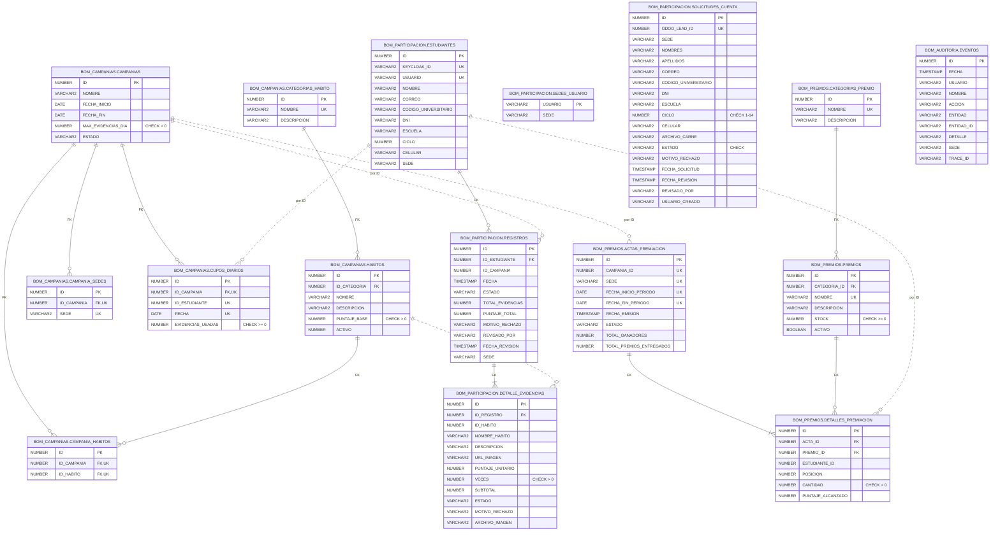

# Modelo de datos

Este es el modelo **real** de la base del sistema: Oracle 23ai, tal como lo dejan creado los scripts de la carpeta `sql/` en el orden de la [Guía de ejecución](../../guia-ejecucion.md) (S12, S14, S15, S16, S17, S19, S20, S21 y S22). Coincide columna por columna con las entidades JPA del backend, que arranca con `ddl-auto: validate`: si una tabla o columna no existiera, la aplicación no levantaría.

## 1. Esquemas

| Esquema | Módulo del backend | Tablas |
|---|---|---|
| `BOM_CAMPANIAS` | `campanias` | `CATEGORIAS_HABITO`, `HABITOS`, `CAMPANIAS`, `CAMPANIA_HABITOS`, `CAMPANIA_SEDES`, `CUPOS_DIARIOS` |
| `BOM_PARTICIPACION` | `participacion`, `cuentas` y `sedes` | `ESTUDIANTES`, `REGISTROS`, `DETALLE_EVIDENCIAS`, `SOLICITUDES_CUENTA`, `SEDES_USUARIO` |
| `BOM_PREMIOS` | `premios` | `CATEGORIAS_PREMIO`, `PREMIOS`, `ACTAS_PREMIACION`, `DETALLES_PREMIACION` |
| `BOM_AUDITORIA` | `auditoria` | `EVENTOS` |

Son 16 tablas en 4 esquemas. La aplicación se conecta como `BOMERP_APP`, que no es dueño de ningún esquema: solo tiene `CREATE SESSION` y permisos por tabla.

`BOM_CATALOGO` y `BOM_VENTAS` también existen en la base, pero son el ejemplo guiado del docente (`catalogo` y `ventas`) y no forman parte del dominio del proyecto.

## 2. Diagrama

Línea continua: llave foránea real en Oracle. Línea punteada: referencia por ID entre esquemas distintos, sin llave foránea, por la decisión ADR-02 (cada módulo es dueño de sus tablas).

## 3. Restricciones

| Tabla | Restricción | Qué protege |
|---|---|---|
| `CUPOS_DIARIOS` | `UK_CUPO_DIA` (campaña, estudiante, fecha), `CK_CUPO_USADAS` | Una sola fila de cupo por estudiante y día; las evidencias usadas nunca son negativas |
| `CAMPANIAS` | `CK_CAMPANIA_MAX` | El máximo de evidencias por día es mayor que cero |
| `CAMPANIA_HABITOS` | `UK_CAMPANIA_HABITO` | Un hábito no se repite dentro de una campaña |
| `CAMPANIA_SEDES` | `UK_CAMPANIA_SEDE`, `CK_CAMPANIA_SEDE` | Una campaña no se repite en una sede; solo Lima, Juliaca o Tarapoto |
| `CATEGORIAS_HABITO` | `UK_CATEGORIA_HABITO_NOMBRE` | No hay dos categorías con el mismo nombre |
| `HABITOS` | `CK_HABITO_PUNTAJE` | El puntaje base es mayor que cero |
| `REGISTROS` | `CK_REGISTRO_PUNTAJE`, `CK_REGISTRO_TOTALEV`, `CK_REGISTRO_SEDE` | Puntaje no negativo, al menos una evidencia y sede válida |
| `DETALLE_EVIDENCIAS` | `CK_EVID_VECES`, `CK_EVID_SUBTOTAL`, `CK_DETALLE_ESTADO` | Veces mayor que cero, subtotal no negativo y uno de `BORRADOR`, `ENVIADO`, `VALIDADO`, `RECHAZADO` o `ANULADO` |
| `ESTUDIANTES` | `UK_ESTUDIANTE_KEYCLOAK`, `UK_ESTUDIANTE_USUARIO`, `CK_ESTUDIANTE_SEDE` | Un estudiante por cuenta de Keycloak y por usuario |
| `SOLICITUDES_CUENTA` | `CK_SOLICITUD_ESTADO`, `CK_SOLICITUD_CICLO` y el índice único `UX_SOLICITUD_LEAD` | Estado válido, ciclo de 1 a 14 y un solo registro por lead de Odoo |
| `SEDES_USUARIO` | `CK_SEDE_USUARIO` | Solo Lima, Juliaca o Tarapoto |
| `CATEGORIAS_PREMIO` | `UK_CATEGORIA_PREMIO_NOMBRE` | No hay dos categorías de premio con el mismo nombre |
| `PREMIOS` | `UK_PREMIO_NOMBRE`, `CK_PREMIO_STOCK` | Nombre único y stock nunca negativo |
| `ACTAS_PREMIACION` | `UK_ACTA_CAMPANIA_PERIODO` (campaña, sede, inicio, fin), `CK_ACTA_ESTADO`, `CK_ACTA_PERIODO`, `CK_ACTA_SEDE` | No hay dos actas del mismo periodo, campaña y sede; estado `EMITIDA` o `ANULADA`; el fin no es antes del inicio |
| `DETALLES_PREMIACION` | `CK_DETALLE_CANTIDAD`, `CK_DETALLE_POSICION` | Cantidad y posición mayores que cero |

### Llaves foráneas

| Llave | De | A |
|---|---|---|
| `FK_HABITO_CATEGORIA` | `HABITOS.ID_CATEGORIA` | `CATEGORIAS_HABITO.ID` |
| `FK_CH_CAMPANIA`, `FK_CH_HABITO` | `CAMPANIA_HABITOS` | `CAMPANIAS`, `HABITOS` |
| `FK_CS_CAMPANIA` | `CAMPANIA_SEDES.ID_CAMPANIA` | `CAMPANIAS.ID` |
| `FK_CUPO_CAMPANIA` | `CUPOS_DIARIOS.ID_CAMPANIA` | `CAMPANIAS.ID` |
| `FK_REGISTRO_ESTUDIANTE` | `REGISTROS.ID_ESTUDIANTE` | `ESTUDIANTES.ID` |
| `FK_EVIDENCIA_REGISTRO` | `DETALLE_EVIDENCIAS.ID_REGISTRO` | `REGISTROS.ID` |
| `FK_PREMIO_CATEGORIA` | `PREMIOS.CATEGORIA_ID` | `CATEGORIAS_PREMIO.ID` |
| `FK_DETALLE_ACTA` | `DETALLES_PREMIACION.ACTA_ID` | `ACTAS_PREMIACION.ID` |
| `FK_DETALLE_PREMIO` | `DETALLES_PREMIACION.PREMIO_ID` | `PREMIOS.ID` |

### Referencias por ID entre esquemas (sin llave foránea)

| Columna | Apunta a | Por qué no hay FK |
|---|---|---|
| `REGISTROS.ID_CAMPANIA` | `BOM_CAMPANIAS.CAMPANIAS` | Otro esquema; el módulo `participacion` consulta la campaña por `CampaniaService` |
| `DETALLE_EVIDENCIAS.ID_HABITO` | `BOM_CAMPANIAS.HABITOS` | Otro esquema; además el detalle copia `NOMBRE_HABITO` y `PUNTAJE_UNITARIO` como dato histórico |
| `CUPOS_DIARIOS.ID_ESTUDIANTE` | `BOM_PARTICIPACION.ESTUDIANTES` | Otro esquema |
| `ACTAS_PREMIACION.CAMPANIA_ID` | `BOM_CAMPANIAS.CAMPANIAS` | Otro esquema |
| `DETALLES_PREMIACION.ESTUDIANTE_ID` | `BOM_PARTICIPACION.ESTUDIANTES` | Otro esquema |

## 4. Índices

| Índice | Columnas | Para qué consulta |
|---|---|---|
| `IX_REGISTRO_SEDE` | `REGISTROS (SEDE, ESTADO, FECHA)` | Bandeja de validación y reporte de cada sede |
| `IX_REGISTRO_ESTUDIANTE` | `REGISTROS (ID_ESTUDIANTE)` | "Mis registros" y la llave foránea al estudiante |
| `IX_EVIDENCIA_REGISTRO` | `DETALLE_EVIDENCIAS (ID_REGISTRO)` | Cargar las evidencias de un registro |
| `IX_DETALLE_ACTA`, `IX_DETALLE_PREMIO` | `DETALLES_PREMIACION` | Detalle de un acta y premios ya entregados |
| `IX_SOLICITUD_ESTADO` | `SOLICITUDES_CUENTA (ESTADO, FECHA_SOLICITUD)` | Solicitudes por revisar |
| `IX_EVENTOS_FECHA`, `IX_EVENTOS_ACCION` | `EVENTOS` | Consulta de la auditoría por fecha y por acción |

Las llaves primarias y las restricciones `UNIQUE` crean además su propio índice.

## 5. Particionamiento

`REGISTROS` está particionada por rango de `FECHA` con `INTERVAL` mensual (`S22`). La primera partición, `P_INICIAL`, guarda todo lo anterior a 2026; desde ahí Oracle crea sola una partición nueva cada vez que llega un registro de un mes que todavía no tiene la suya.

La tabla sigue siendo una sola para la aplicación: las consultas y las entidades JPA no cambiaron.

## 6. PL/SQL

| Objeto | Esquema | Qué hace |
|---|---|---|
| `OBTENER_PUNTAJE_ESTUDIANTE (estudiante, campaña)` | `BOM_PARTICIPACION` | Suma solo los puntos de evidencias `VALIDADO`, igual que el ranking. Si el estudiante no existe lanza `ORA-20001` |
| `HABITO_MAS_REGISTRADO (campaña, sede)` | `BOM_PARTICIPACION` | Devuelve el hábito con más veces registradas; si no hay registros devuelve "Sin registros" (`NO_DATA_FOUND`) |
| `TRG_EVENTOS_INMUTABLE` | `BOM_AUDITORIA` | Trigger `BEFORE UPDATE OR DELETE` sobre `EVENTOS`: lanza `ORA-20010` con el ID y el usuario del evento (`:OLD`). Ni el dueño del esquema puede alterar la auditoría sin deshabilitarlo |

## 7. Privilegios

| Usuario | Permisos |
|---|---|
| `BOMERP_APP` | `CREATE SESSION`; `SELECT, INSERT, UPDATE, DELETE` sobre las tablas de negocio |
| `BOMERP_APP` sobre `BOM_AUDITORIA.EVENTOS` | Solo `SELECT` e `INSERT`: un evento de auditoría no se puede modificar ni borrar desde la aplicación |
| `ROL_REPORTES` | Solo `SELECT` sobre registros, evidencias, estudiantes y eventos, y `EXECUTE` sobre las dos funciones: para quien solo necesita consultar |
| Dueños de esquema (`BOM_CAMPANIAS`, `BOM_PARTICIPACION`, `BOM_PREMIOS`, `BOM_AUDITORIA`) | `CREATE SESSION`, `CREATE TABLE`, `CREATE VIEW`; la aplicación nunca se conecta con ellos |
